# GitHub Copilot agents for Azure DevOps — a working playbook

[](https://github.com/iverburgh/copilot-azure-devops-playbook/actions/workflows/ci.yml)

Custom agents, skills and prompts for GitHub Copilot in VS Code that take a backlog item from rough
idea to merged pull request on Azure DevOps — and that investigate what goes wrong afterwards.

Most published Copilot customizations assume GitHub: issues, GitHub Actions, the GitHub MCP server.
Teams on Azure DevOps get little of that, and the Azure CLI has a few traps that silently destroy
data. This repository is the Azure DevOps half.

Everything here came out of daily use by a development team on a large .NET and TypeScript
monorepo with Azure DevOps Boards, Repos, Pipelines and a wiki holding the functional design and
architecture decisions. The behaviour described comes from real use, not from reading
documentation.

## Start here

| If you want to… | Read |
|---|---|
| Install this in your own repository | [docs/getting-started.md](docs/getting-started.md) |
| Refine a backlog item — against the functional design and the ADRs | [docs/refinement.md](docs/refinement.md) |
| Break an item into tasks, write REPs, and let specialists implement them | [docs/planning-and-reps.md](docs/planning-and-reps.md) |
| Get a pull request title and description from your branch | [docs/pull-request-descriptions.md](docs/pull-request-descriptions.md) |
| Find the root cause of a production issue | [docs/azure-issue-investigation.md](docs/azure-issue-investigation.md) |
| Find out why the builds on a pull request fail | [docs/pr-pipeline-analysis.md](docs/pr-pipeline-analysis.md) |
| Research an open technical question | [docs/technical-spikes.md](docs/technical-spikes.md) |
| Understand how instructions, skills, agents and prompts fit together | [docs/instructions.md](docs/instructions.md) |
| **Avoid the traps that silently lose data** | **[docs/pitfalls.md](docs/pitfalls.md)** |

## The workflow

```mermaid
flowchart LR
    idea[Rough backlog item] -->|/refine| refiner[PBI Refiner]
    refiner -->|functional design + ADR check,<br/>open points as multiple choice| refined[Refined item]
    refined -->|/breakdown-pbi| planner[PBI Planner]
    planner --> tasks[Tasks with REP content,<br/>one branch and PR each]
    tasks -->|/create-rep| rep[Local REP]
    rep -->|/implement-rep| specialists[Specialists]
    specialists -->|/pr-description| pr[Draft pull request]
    pr -->|red build| analyzer[PR Pipeline Analyzer]
    prod[Production issue] --> investigator[Azure Issue Investigator]
    question[Open technical question] --> spike[Technical spike]
    investigator -->|follow-up items| idea
    spike -->|follow-up items| idea
```



Each step works on its own; you do not need the whole chain to get value from one agent.

## What each part gives you

- **PBI Refiner** analyses an item against the code, then puts **every change next to the
  functional design and the architecture decision records**. Behaviour the design does not describe
  yet becomes a documentation requirement in the acceptance criteria; a change that *contradicts*
  the design or an ADR stops the refinement until you explicitly confirm which one wins. Open points
  come back as **multiple-choice questions**, which turns a refinement session into a few clicks.
  The same question style works for any task (`/clarify-open-points`).
- **PBI Planner** breaks a refined item into Azure DevOps tasks that **each go through their own
  branch and pull request**, ordered so every PR is deployable on its own, and each carrying as much
  detail as a REP. Test-driven by default.
- **REPs** (Refined Execution Packets) are the contract for one task: what must be true afterwards,
  not how to write it. A REP names the **specialists** it needs — backend, database, frontend,
  platform, testers — and each can be run separately: *"Implement the REP for specialist X"*.
- **PR descriptions** from the branch diff, around 2000 characters, never above the 4000 that Azure
  DevOps accepts.
- **Azure Issue Investigator** combines Application Insights and Log Analytics with the code to get
  to one or more root causes, and advises on mitigation now, a temporary fix, and follow-up items.
- **PR Pipeline Analyzer** takes a pull request number and explains every failing build, test and
  task, separating what the PR broke from what was already broken or flaky.
- **Technical spike research mode** turns a question like *"we want messages delivered idempotently
  — where do we stand and what do you recommend?"* into a researched recommendation and follow-up
  items.

## What's in here

```
.github/agents/        Custom agents (select them in the Copilot chat agent picker)
.github/skills/        Skills the agents load on demand, some with PowerShell scripts
.github/instructions/  Coding conventions that load automatically for the files being edited
.github/prompts/       Slash commands for the everyday instructions
templates/             The configuration block to paste into your copilot-instructions.md
docs/                  How to use each workflow, and the pitfalls behind the design
tools/                 Checks that keep this repository honest, also run in CI
```

Some files come from [github/awesome-copilot](https://github.com/github/awesome-copilot): the
**Technical spike research mode** agent, the **azure-devops-cli** and **create-technical-spike**
skills and the **Azure DevOps pipelines** and **PowerShell** instructions unmodified; the **C#** and
**Pester** instructions derived from upstream versions. See
[THIRD-PARTY-NOTICES.md](THIRD-PARTY-NOTICES.md) for the pinned commit and license. Everything else
is original to this repository.

## Adapting this to your repository

Nothing here is drop-in. The agents read your organization, project, wiki and build commands from
one block in your `copilot-instructions.md`, and the specialists decide who owns what from a
path-mapping table that must match your layout. [docs/getting-started.md](docs/getting-started.md)
walks through both.

## Further reading

- [Custom agents in VS Code](https://code.visualstudio.com/docs/copilot/customization/custom-agents),
  [agent skills](https://code.visualstudio.com/docs/copilot/customization/agent-skills) and
  [prompt files](https://code.visualstudio.com/docs/copilot/customization/prompt-files) — the
  reference for every file type used here.
- [github/awesome-copilot](https://github.com/github/awesome-copilot) — the community collection
  this playbook borrows from and complements.
- [Azure DevOps CLI](https://learn.microsoft.com/azure/devops/cli/) and the
  [work item REST API](https://learn.microsoft.com/rest/api/azure/devops/wit/work-items/update) — for
  everything the skills call.

## License

MIT — see [LICENSE](LICENSE). Third-party files keep their own license; see
[THIRD-PARTY-NOTICES.md](THIRD-PARTY-NOTICES.md).
